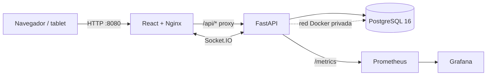

# ComandaPro — Sistema de pedidos para restaurantes en tiempo real

**Proyecto académico de Automatización de Infraestructura Digital I**  
**Caso:** ComandaPro — Sistema de pedidos para restaurantes con cocina en tiempo real.  
**Tecnologías exigidas por el instrumento global:** FastAPI (Python), React, Docker Compose, GitHub Actions, Prometheus y Grafana.

> **Alcance del prototipo:** este repositorio contiene una implementación educativa para demostrar autenticación, autorización, flujo de comandas, descuento de inventario, pagos divididos, eventos en tiempo real, auditoría, reportes, pruebas, CI y monitoreo. Los pagos se registran dentro del sistema; no se conecta a un procesador bancario real. Antes de cualquier uso fuera del laboratorio se deben cambiar todas las contraseñas/secretos, revisar controles de seguridad, respaldos, TLS, migraciones y políticas de privacidad.

## 1. Arquitectura



Docker Compose administra seis servicios: `db`, `api`, `web`, `cadvisor`, `prometheus` y `grafana`. Solamente se publica en la interfaz local del equipo el frontend en el puerto `8080`, Prometheus en `9090` y Grafana en `3001`; PostgreSQL y FastAPI no exponen sus puertos directamente al host.

| Servicio | Base/imagen | Puerto de host | Restricciones Compose |
|---|---|---:|---|
| `db` | `postgres:16-alpine` | Interno `5432` | 0.75 CPU, 512 MiB, 160 procesos |
| `api` | Imagen construida con Python 3.12 | Interno `8000` | 1 CPU, 768 MiB, 256 procesos |
| `web` | React compilado y `nginx:1.27-alpine` | `127.0.0.1:8080` | 0.5 CPU, 192 MiB, 128 procesos |
| `cadvisor` | `ghcr.io/google/cadvisor:0.60.6` | Interno `8080` | 0.5 CPU, 512 MiB, 128 procesos |
| `prometheus` | `prom/prometheus:v3.1.0` | `127.0.0.1:9090` | 0.5 CPU, 256 MiB, 128 procesos |
| `grafana` | `grafana/grafana:11.4.0` | `127.0.0.1:3001` | 0.5 CPU, 256 MiB, 128 procesos |

cAdvisor obtiene datos de uso de CPU, memoria y red de contenedores con montajes de observación de solo lectura. No publica su puerto al host; Prometheus accede por la red interna. Los montajes `/sys` y `/var/lib/docker` están orientados a Docker Engine en Linux; en Docker Desktop o en hosts con otro runtime se debe comprobar la disponibilidad de las métricas y adaptar los montajes. El socket Docker no debe exponerse fuera de un entorno de confianza.

La red `comandapro-interna` permite que la API use el nombre de servicio `db` como host PostgreSQL y que Nginx reenvíe `/api/` y `/socket.io/` a `api:8000`. Los healthchecks y `depends_on: condition: service_healthy` controlan el orden de arranque. Los datos de la base, Prometheus y Grafana se conservan en volúmenes nombrados.

## 2. Modelo de datos

El esquema sigue las tablas de la guía de ComandaPro e incorpora campos operativos necesarios para controlar estados y evitar reintegros duplicados.

| Tabla | Propósito |
|---|---|
| `sucursales` | Datos y estado de las tres sucursales iniciales |
| `roles` | ADMIN, MESERO, COCINA y CAJERO; permite roles adicionales |
| `permisos` | Claves configurables como `ordenes.crear` y `pagos.crear` |
| `rol_permiso` | Relación N:M entre roles y permisos |
| `usuarios` | Correo, hash de contraseña, rol y sucursal asignada |
| `refresh_tokens` | Hash de token, expiración, revocación y rotación |
| `mesas` | Mesas y estado por sucursal |
| `categorias`, `productos` | Catálogo de platillos con precios y estado activo |
| `insumos`, `recetas` | Ingredientes, unidad de medida y consumo por producto |
| `inventario` | Existencia y mínimo de cada insumo por sucursal |
| `movimientos_inventario` | Entradas, ajustes y consumo/reintegro por orden |
| `ordenes`, `detalle_orden` | Cuenta principal y estado independiente de cada platillo |
| `pagos` | Varios pagos por orden y cajero que registra cada uno |
| `bitacora` | Registro automático de mutaciones exitosas de la API |

Relaciones principales:

- Una sucursal tiene usuarios, mesas, registros de inventario y órdenes.
- Los roles se vinculan con los permisos mediante `rol_permiso`.
- Los productos consumen insumos mediante `recetas`; el inventario se mantiene por sucursal.
- Una orden contiene varios detalles/platillos y puede tener varios pagos.
- Los movimientos de inventario conservan la trazabilidad del consumo por orden.

## 3. Funcionalidades implementadas

### Administración

- Gestión de sucursales, usuarios, roles y matriz configurable de permisos.
- Catálogo CRUD de categorías, productos y recetas.
- Alta/edición de insumos, mesas y ajustes de inventario.
- Inventario por sucursal, movimientos registrados y alertas de stock mínimo.
- Dashboard, ventas por sucursal/periodo, productos más vendidos y exportación de ventas a CSV o Excel (`.xlsx`).
- Bitácora de auditoría para operaciones exitosas de escritura.

### Mesero

- Mapa de mesas de su sucursal.
- Creación de una orden con varios productos, cantidades y notas por platillo.
- Edición de detalles mientras la orden está abierta y envío de la comanda a cocina.
- Cancelación de orden y reintegro de ingredientes cuando corresponda.

### Cocina

- Tablero tipo Kanban por estado de platillo.
- Transiciones permitidas `PENDIENTE → PREPARANDO → LISTO`.
- Eventos en vivo por sala Socket.IO `sucursal:{id}` para recibir comandas y cambios de platillos.

### Caja

- Consulta de cuentas servidas y captura de pagos en efectivo, tarjeta o transferencia.
- Pagos divididos; se acepta cada parcial sin cerrar la orden.
- La orden queda `PAGADA` y libera la mesa solamente cuando la suma pagada iguala el total. Un intento de sobrepago se rechaza.

### Reglas críticas

- Estados de orden: `ABIERTA → EN_COCINA → SERVIDA → PAGADA`; también puede pasar a `CANCELADA` cuando las reglas lo permiten.
- Cada platillo tiene estados propios; una orden no puede marcarse servida hasta que todos los platillos activos estén `LISTO`.
- Al enviar a cocina, el backend agrega las necesidades de todos los detalles por insumo, valida todas las existencias y, dentro de una transacción, registra las salidas, descuenta inventario y cambia el estado de la orden. Si alguna existencia es insuficiente, la orden no pasa a cocina y no se confirma el descuento.
- Si se cancela una orden que ya estaba en cocina, los insumos se reintegran y se documentan los movimientos.
- Los endpoints operativos filtran por sucursal de sesión. El acceso se controla en el servidor por permisos; ocultar botones en React no sustituye la autorización de la API.

## 4. Autenticación y seguridad del prototipo

- Contraseñas con hash `PBKDF2-HMAC-SHA256` (no se guardan en texto plano).
- Access token JWT firmado, con expiración configurable por entorno y valor inicial de **15 minutos**.
- Refresh token opaco almacenado en base de datos como hash; cookie HttpOnly, rotación en cada refresh y revocación del token anterior.
- Interceptor Axios: al recibir un 401 de una petición protegida intenta refrescar la sesión una vez y reintenta la petición. Si no puede renovar, limpia la sesión local.
- Permisos por clave (por ejemplo, `ordenes.crear`) aplicados mediante dependencias FastAPI y reflejados en la navegación React.
- Socket.IO exige JWT y une al usuario a la sala de su sucursal.

**Nota de seguridad:** `COOKIE_SECURE=false` y las credenciales del ejemplo son únicamente para ejecución local HTTP. En un despliegue HTTPS se debe activar `COOKIE_SECURE=true`, usar secretos aleatorios, guardar credenciales en un gestor seguro y endurecer CORS. Cambiar un valor en `.env` no actualiza el hash de una contraseña que ya fue sembrada en la base; para cambiar una cuenta existente se requiere un flujo de cambio/reset de contraseña o reinicializar deliberadamente los datos de demo.

## 5. Instalación en Linux

### Prerrequisitos

- Docker Engine/Docker Desktop con Docker Compose v2.
- Git para control de versiones.
- Navegador moderno.
- Conexión a Internet durante la primera construcción, porque se descargan imágenes y dependencias.
- El primer build de frontend necesita consultar el registro npm. Este paquete no incluye `node_modules`; la compilación de React se valida con `npm run build` y `npm test` en una máquina con conectividad o en GitHub Actions.

### Paso 1. Obtener el código

Si ya tienes el ZIP, descomprímelo en una carpeta de trabajo. Para un repositorio remoto, usa la URL del repositorio propio que publiques en GitHub:

```bash
git clone <URL_DEL_REPOSITORIO>
cd ComandaPro
```

### Paso 2. Crear configuración local

```bash
cp .env.example .env
nano .env
```

Cambia `POSTGRES_PASSWORD`, `JWT_SECRET`, `COMANDAPRO_ADMIN_PASSWORD`, `COMANDAPRO_DEMO_PASSWORD` y `GRAFANA_ADMIN_PASSWORD`. Si cambias la contraseña PostgreSQL, actualiza también `DATABASE_URL` usando el carácter URL-encoded correspondiente (por ejemplo `!` como `%21`). Nunca publiques `.env` ni subas contraseñas a GitHub; `.gitignore` excluye ese archivo.

### Paso 3. Validar, construir y levantar

```bash
docker compose config --quiet
docker compose up -d --build
docker compose ps -a
```

Espera a que `db`, `api` y `web` estén saludables. Prometheus y Grafana también deben quedar `Up`. Para revisar los logs:

```bash
docker compose logs -f api
# En otra terminal:
docker compose logs -f web
```

### Paso 4. Abrir la aplicación y herramientas

| Recurso | URL local |
|---|---|
| ComandaPro (React/Nginx) | http://127.0.0.1:8080 |
| Documentación interactiva FastAPI | http://127.0.0.1:8080/api/docs |
| Métricas de la API | Internas en `http://api:8000/metrics`, accesibles desde la red Docker; Prometheus las consulta automáticamente |
| Prometheus | http://127.0.0.1:9090 |
| Grafana | http://127.0.0.1:3001 |

Grafana obtiene datos de Prometheus mediante configuración aprovisionada. Sus credenciales iniciales se definen con `GRAFANA_ADMIN_USER` y `GRAFANA_ADMIN_PASSWORD` dentro de `.env`.

### Paso 5. Cuentas de demostración

El seed inicial crea una cuenta ADMIN y tres usuarios operativos en ComandaPro Centro.

| Rol | Correo | Contraseña de demostración |
|---|---|---|
| ADMIN | `admin@comandapro.local` | Privada: `COMANDAPRO_ADMIN_PASSWORD` (Render / .env) |
| MESERO | `mesero@comandapro.local` | `DemoComandaPro2026!` |
| COCINA | `cocina@comandapro.local` | `DemoComandaPro2026!` |
| CAJERO | `cajero@comandapro.local` | `DemoComandaPro2026!` |

En el entorno público de evaluación: [ComandaPro en Render](https://comandapro-demo.onrender.com). Estas son **credenciales públicas y exclusivamente de demostración**: cualquier persona con el enlace puede utilizar las cuentas operativas y modificar pedidos, inventario o cobros simulados. No almacenar información real de clientes ni usarlas para operar un restaurante. El administrador mantiene una contraseña privada diferente y no publicada.

La contraseña inicial de nuevas instalaciones se controla con `COMANDAPRO_DEMO_PASSWORD`; cuentas ya existentes conservan su hash salvo que administración las restablezca. Para una rotación puntual en la instancia de pruebas, `COMANDAPRO_RESET_DEMO_PASSWORDS_ON_STARTUP=true` actualiza solamente las tres cuentas iniciales predeterminadas al arrancar; debe volver a `false` inmediatamente después. En máquinas existentes, ajusta `.env` si deseas el mismo valor local.

### Paso 6. Probar el flujo principal

1. Entra como MESERO, selecciona una mesa libre, agrega Hamburguesa Comanda u otro platillo y envía la orden.
2. En otra sesión/navegador entra como COCINA; debe aparecer la comanda. Cambia el platillo a `PREPARANDO` y luego `LISTO`.
3. Como MESERO, marca la orden como servida cuando todos sus detalles estén listos.
4. Como CAJERO, registra un primer pago parcial y confirma que queda saldo pendiente; registra el pago restante y verifica que la orden cambie a `PAGADA` y la mesa quede libre.
5. Como ADMIN, revisa los movimientos de insumos, reportes por sucursal, matriz de permisos y bitácora.

## 6. API principal

La interfaz usa la API bajo `/api`; la documentación interactiva está en `/api/docs`.

| Método y ruta | Función |
|---|---|
| `POST /api/auth/login` | Login, emite access token y refresh cookie |
| `POST /api/auth/refresh` | Rota refresh token y emite nuevo access token |
| `POST /api/auth/logout` | Revoca la sesión/refresh token |
| `GET /api/auth/me` | Perfil y permisos efectivos |
| `GET/POST/PATCH /api/admin/usuarios` | Consulta y gestión de usuarios (según permiso/sucursal) |
| `/api/admin/roles`, `/api/admin/permisos` | CRUD y matriz de permisos |
| `/api/productos`, `/api/categorias`, `/api/productos/{id}/receta` | Catálogo y recetas |
| `/api/insumos`, `/api/inventario`, `/api/inventario/{id}/movimientos` | Insumos, existencias y movimientos |
| `/api/mesas` | Mesas de la sucursal actual |
| `/api/ordenes` | Creación, consulta y detalle de órdenes |
| `POST /api/ordenes/{id}/enviar-cocina` | Valida/descuenta insumos y publica la comanda |
| `GET /api/cocina/ordenes` | Tablero de cocina |
| `PATCH /api/cocina/detalles/{id}/estado` | Actualiza estado del platillo |
| `POST /api/ordenes/{id}/pagos` | Pago parcial/completo con control del total |
| `/api/reportes/ventas`, `/api/reportes/productos-mas-vendidos`, `/api/reportes/stock-bajo` | Reportes agregados |
| `/api/reportes/ventas.csv`, `/api/reportes/ventas.xlsx` | Exportación |
| `GET /api/bitacora` | Auditoría filtrada por sucursal |

## 7. Pruebas

### Backend

Las pruebas están en `backend/tests/`. Usan SQLite efímero para aislar datos y comprueban autenticación, expiración y firma JWT, rotación y revocación de refresh tokens, permisos por sucursal, ciclo de una orden con descuento de receta y pagos divididos, falta de stock, reintegro al cancelar, rechazo de sobrepago y exportación Excel.

```bash
cd backend
python -m venv .venv
source .venv/bin/activate
pip install -r requirements.txt
pytest -q
```

### Frontend

```bash
cd frontend
npm install
npm test
npm run build
```

El frontend incluye pruebas unitarias con Vitest para el cálculo de pagos divididos, normalización de estados e importes. La construcción de ambas imágenes ejecuta sus pruebas antes de producir la imagen de ejecución.

### Integración, carga y persistencia

- Compose incluye healthchecks y dependencias condicionadas por `service_healthy`.
- La prueba funcional cubre creación y envío de una orden, descuento de ingredientes, transición de platillos, servicio y pago dividido.
- La prueba ligera de carga indicada en `scripts/prueba_carga.py` realiza 40 solicitudes a `/api/health` con hasta cuatro concurrentes y registra latencias; no representa una prueba de capacidad máxima ni de ventas concurrentes.
- La persistencia se verifica reiniciando servicios sin borrar volúmenes y comparando conteos de `usuarios`, `categorias`, `productos`, `inventario` y `ordenes`.

Para ejecutar la prueba de carga localmente cuando Compose esté arriba:

```bash
python scripts/prueba_carga.py
# Opcional: más peticiones (ajusta el volumen con cuidado)
python scripts/prueba_carga.py --requests 100 --concurrency 8
```

La comprobación de persistencia registra conteos antes/después del reinicio y no borra volúmenes:

```bash
./scripts/comprobar_persistencia.sh
```

Para comprobar que los contenedores siguen activos:

```bash
docker compose ps -a
docker stats --no-stream
```

## 8. Observabilidad con Prometheus y Grafana

FastAPI expone `/metrics` con un contador de solicitudes por método, ruta y código HTTP, además de un histograma de latencia. Prometheus obtiene esas métricas de `api:8000/metrics` cada 15 segundos y también recoge métricas de cAdvisor en `cadvisor:8080/metrics`. Grafana tiene un dashboard aprovisionado con:

- tasa de solicitudes HTTP agrupadas por código;
- latencia aproximada p95 de solicitudes;
- respuestas de error 5xx;
- CPU utilizada por cada servicio Docker (núcleos de CPU);
- memoria de trabajo por servicio Docker;
- tráfico de red recibido por servicio.

**Comprobación para la evaluación:** abre `http://127.0.0.1:9090/targets` y verifica que los objetivos `comandapro-api` y `comandapro-contenedores` estén en estado **UP**. En Grafana (`http://127.0.0.1:3001`), abre **ComandaPro - Observabilidad** y comprueba los seis paneles. Si aparecen gráficos vacíos, genera tráfico a la API y espera a que transcurran varias recolecciones; confirma que cAdvisor está ejecutándose y que Docker Engine permite los montajes. Captura los targets y los paneles para la evidencia. Los nombres de las métricas y etiquetas disponibles se pueden comprobar en la página de consulta de Prometheus.

La dirección pública local de Prometheus es `http://127.0.0.1:9090`; Grafana es `http://127.0.0.1:3001`.

## 9. CI/CD con GitHub Actions

El flujo `.github/workflows/ci.yml` se activa en `push` y `pull_request` hacia `main`. Ejecuta las pruebas del backend, las pruebas y build del frontend, construye ambas imágenes y realiza una prueba de humo con Docker Compose para comprobar los endpoints y las métricas. En un `push` válido a `main`, el job `publish-images` publica las imágenes en GitHub Container Registry (GHCR) con las etiquetas `latest` y el SHA del commit. Los permisos `packages: write` se conceden únicamente a ese job.

El despliegue remoto es **opcional y está desactivado por defecto**. Para habilitarlo, primero debe existir un servidor accesible por SSH con Docker Compose, un clon actualizado del repositorio y su archivo `.env` privado. En GitHub configura la variable de repositorio `ENABLE_REMOTE_DEPLOY=true` y estos secretos: `DEPLOY_HOST`, `DEPLOY_USER`, `DEPLOY_SSH_KEY`, `DEPLOY_PATH` y `GHCR_PULL_TOKEN` (token con permiso de lectura de paquetes). En el `.env` del servidor define `COMANDAPRO_API_IMAGE=ghcr.io/<propietario-en-minúsculas>/comandapro-api:latest` y `COMANDAPRO_WEB_IMAGE=ghcr.io/<propietario-en-minúsculas>/comandapro-web:latest`. La acción remota inicia sesión en GHCR, actualiza `main`, descarga las imágenes y ejecuta `docker compose up -d --no-build`. No se ha realizado un despliegue remoto desde este entorno porque no se proporcionaron servidor ni credenciales; el job solo se activa cuando se configura esa variable y esos secretos.

**Estado de validación del paquete:** las 14 pruebas del backend pasaron con las dependencias reales (incluido `python-socketio`), y en el frontend pasaron las pruebas de Vitest y se completó `npm run build`. La construcción de imágenes y el arranque de los cinco servicios con Docker se comprueban en el equipo del autor y en la pestaña **Actions** de GitHub; el resultado verde de CI debe revisarse antes de presentar el proyecto.

## 10. Apagar sin borrar los datos

```bash
docker compose down
```

Este comando detiene y elimina los contenedores/red de este proyecto, pero conserva los volúmenes nombrados. **No ejecutes `docker compose down -v` si necesitas conservar la base de datos, métricas y dashboard.**

## 11. Repositorio y control de versiones

Para publicar el proyecto en una cuenta propia:

1. Crea un repositorio vacío en GitHub, por ejemplo `ComandaPro` (sin README ni licencia inicial para evitar conflictos).
2. Desde esta carpeta añade la dirección real que GitHub te proporcione y publica la rama `main`:

```bash
git remote add origin <URL_REAL_DEL_REPOSITORIO>
git branch -M main
git push -u origin main
```

Después revisa en GitHub que estén publicados `docker-compose.yml`, `backend/Dockerfile`, `frontend/Dockerfile`, `.github/workflows/ci.yml`, `monitoring/`, este README y las pruebas. No publiques el archivo `.env`.

## 12. Entrega de la actividad 3 (instrumento global)

La aplicación emplea **FastAPI (Python), React (TypeScript), PostgreSQL, Docker Compose, GitHub Actions, Prometheus, Grafana y cAdvisor**. El historial de commits, los Dockerfiles y la arquitectura Mermaid son públicos en este repositorio. Antes de entregar, comprueba el pipeline verde en la pestaña Actions, el flujo funcional de mesero a cocina y caja, y los dos objetivos UP de Prometheus. Conserva capturas con fecha de GitHub Actions, Docker Compose, Grafana y el flujo de la aplicación.

**Alcance comprobable del despliegue:** el pipeline construye, prueba y publica imágenes en GitHub Container Registry. También prueba el despliegue local en un runner efímero mediante Compose. El trabajo `deploy-remote` está configurado como opción pero solo se ejecuta al habilitar explícitamente `ENABLE_REMOTE_DEPLOY=true` y proporcionar las credenciales de un servidor. Sin ese servidor, **no se debe afirmar que se desplegó remotamente en producción**. El `README.md` es documentación Markdown; si se entrega como documento impreso se debe aplicar el tamaño carta, márgenes de 2.54 cm y formato tipográfico del instrumento.

## 13. Limitaciones conocidas

- Es un prototipo académico; no se integra con terminales POS ni con un procesador de pagos real.
- La actualización en tiempo real usa Socket.IO; los flujos HTTP/de negocio se prueban por separado, pero una sesión Socket.IO real entre dos navegadores debe validarse también con Docker arriba.
- La prueba de carga propuesta es ligera; no reemplaza pruebas de estrés con grandes volúmenes y datos representativos.
- El esquema se inicializa con `SQLAlchemy create_all` al iniciar el API; para producción debe adoptarse un sistema versionado de migraciones, respaldos, TLS, administración de secretos, hardening de CORS, logging centralizado y políticas de retención de auditoría.
- Los usuarios iniciales son datos de demostración para el laboratorio. No se deben usar las credenciales de ejemplo fuera de local.
