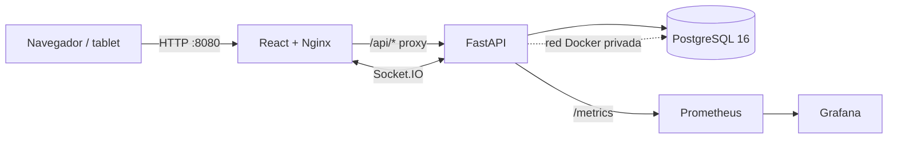

# ComandaPro — Sistema de pedidos para restaurantes en tiempo real

**Asignatura:** Automatización de Infraestructura Digital I · **Evaluación global (unidades I, II y III)**  
**Autor:** Alan Eusebio Méndez Fernández · Ingeniería en Redes Inteligentes y Ciberseguridad, UTNG  
**Repositorio:** [RoxyRg/ComandaPro](https://github.com/RoxyRg/ComandaPro) · **Aplicación publicada:** [ComandaPro en Render](https://comandapro-demo.onrender.com)

## Introducción

En este repositorio presento mi proyecto global ComandaPro. Lo desarrollé como un prototipo para resolver un problema común en un restaurante: los pedidos deben pasar de las mesas a la cocina y después a caja sin perder información. Elegí manejar las operaciones por sucursal, diferenciar los permisos de administrador, mesero, cocina y cajero, y conservar el historial de cada orden. Mi objetivo fue que un pedido pudiera registrarse, prepararse, entregarse y cobrarse dentro de una misma aplicación.

Para el servidor utilicé Python con FastAPI y SQLAlchemy; desarrollé la interfaz con React y TypeScript, y almacené los registros en PostgreSQL. Preparé Docker Compose para levantar la aplicación y sus herramientas de monitoreo en Linux. Además, configuré GitHub Actions para comprobar automáticamente las pruebas del código, construir las imágenes y publicarlas en GitHub Container Registry. Con Prometheus, Grafana y cAdvisor revisé tanto las peticiones HTTP como el consumo de los contenedores.

Al principio ejecuté todo en mi laptop. Después preparé una versión accesible por Internet con Render, conservando React, FastAPI y PostgreSQL, aunque en esta modalidad gratuita el monitoreo completo de contenedores permanece en Docker Compose local. Comprobé el funcionamiento de la versión remota mediante una prueba de integración que inició sesión con tres cuentas distintas, registró una comanda, la envió a cocina, actualizó el estado de preparación y registró dos pagos hasta liberar la mesa.

En los apartados siguientes explico cómo organicé los servicios, qué operaciones implementé, cómo se instala el entorno, qué pruebas ejecuté y dónde guardé los resultados. Documenté también las limitaciones para no confundir el comportamiento de un prototipo académico con el de un sistema listo para un restaurante real.

**Alcance:** registré pagos simulados dentro de mi base de datos; no conecté una pasarela bancaria. El servicio gratuito de Render puede suspenderse por inactividad y su PostgreSQL gratuito tiene caducidad. La documentación del proyecto no debe interpretarse como una garantía de disponibilidad permanente.

## 1. Arquitectura



En mi despliegue local organicé seis servicios con Docker Compose: `db`, `api`, `web`, `cadvisor`, `prometheus` y `grafana`. Solamente se publica en la interfaz local del equipo el frontend en el puerto `8080`, Prometheus en `9090` y Grafana en `3001`; PostgreSQL y FastAPI no exponen sus puertos directamente al host.

| Servicio | Base/imagen | Puerto de host | Restricciones Compose |
|---|---|---:|---|
| `db` | `postgres:16-alpine` | Interno `5432` | 0.75 CPU, 512 MiB, 160 procesos |
| `api` | Imagen construida con Python 3.12 | Interno `8000` | 1 CPU, 768 MiB, 256 procesos |
| `web` | React compilado y `nginx:1.27-alpine` | `127.0.0.1:8080` | 0.5 CPU, 192 MiB, 128 procesos |
| `cadvisor` | `ghcr.io/google/cadvisor:0.60.6` | Interno `8080` | 0.5 CPU, 512 MiB, 128 procesos |
| `prometheus` | `prom/prometheus:v3.1.0` | `127.0.0.1:9090` | 0.5 CPU, 256 MiB, 128 procesos |
| `grafana` | `grafana/grafana:11.4.0` | `127.0.0.1:3001` | 0.5 CPU, 256 MiB, 128 procesos |

Incorporé cAdvisor para obtener métricas de CPU, memoria y red de los contenedores mediante montajes de observación de solo lectura. No publica su puerto al host; Prometheus accede por la red interna. Los montajes `/sys` y `/var/lib/docker` están orientados a Docker Engine en Linux; en Docker Desktop o en hosts con otro runtime se debe comprobar la disponibilidad de las métricas y adaptar los montajes. El socket Docker no debe exponerse fuera de un entorno de confianza.

Configuré la red `comandapro-interna` para que mi API se comunique con PostgreSQL mediante el host `db` y para que Nginx reenvíe `/api/` y `/socket.io/` a `api:8000`. Los healthchecks y `depends_on: condition: service_healthy` controlan el orden de arranque. Los datos de la base, Prometheus y Grafana se conservan en volúmenes nombrados.

## 2. Modelo de datos

Diseñé el esquema a partir del caso de estudio y agregué campos operativos para controlar los estados y evitar reintegros duplicados. Estas son las tablas que utilicé:

| Tabla | Propósito |
|---|---|
| `sucursales` | Datos y estado de las tres sucursales iniciales |
| `roles` | ADMIN, MESERO, COCINA y CAJERO; permite roles adicionales |
| `permisos` | Claves configurables como `ordenes.crear` y `pagos.crear` |
| `rol_permiso` | Relación N:M entre roles y permisos |
| `usuarios` | Correo, hash de contraseña, rol y sucursal asignada |
| `refresh_tokens` | Hash de token, expiración, revocación y rotación |
| `mesas` | Mesas y estado por sucursal |
| `categorias`, `productos` | Catálogo de platillos con precios y estado activo |
| `insumos`, `recetas` | Ingredientes, unidad de medida y consumo por producto |
| `inventario` | Existencia y mínimo de cada insumo por sucursal |
| `movimientos_inventario` | Entradas, ajustes y consumo/reintegro por orden |
| `ordenes`, `detalle_orden` | Cuenta principal y estado independiente de cada platillo |
| `pagos` | Varios pagos por orden y cajero que registra cada uno |
| `bitacora` | Registro automático de mutaciones exitosas de la API |

Relaciones principales:

- Una sucursal tiene usuarios, mesas, registros de inventario y órdenes.
- Los roles se vinculan con los permisos mediante `rol_permiso`.
- Los productos consumen insumos mediante `recetas`; el inventario se mantiene por sucursal.
- Una orden contiene varios detalles/platillos y puede tener varios pagos.
- Los movimientos de inventario conservan la trazabilidad del consumo por orden.

## 3. Funcionalidades que implementé

Separé las funciones según el trabajo de cada usuario. Como administrador puedo administrar la información del restaurante; las otras cuentas trabajan únicamente con las operaciones permitidas por su rol y sucursal.

### Administración

- Gestión de sucursales, usuarios, roles y matriz configurable de permisos.
- Catálogo CRUD de categorías, productos y recetas.
- Alta/edición de insumos, mesas y ajustes de inventario.
- Inventario por sucursal, movimientos registrados y alertas de stock mínimo.
- Dashboard, ventas por sucursal/periodo, productos más vendidos y exportación de ventas a CSV o Excel (`.xlsx`).
- Bitácora de auditoría para operaciones exitosas de escritura.

### Mesero

- Mapa de mesas de su sucursal.
- Creación de una orden con varios productos, cantidades y notas por platillo.
- Edición de detalles mientras la orden está abierta y envío de la comanda a cocina.
- Cancelación de orden y reintegro de ingredientes cuando corresponda.

### Cocina

- Tablero tipo Kanban por estado de platillo.
- Transiciones permitidas `PENDIENTE → PREPARANDO → LISTO`.
- Eventos en vivo por sala Socket.IO `sucursal:{id}` para recibir comandas y cambios de platillos.

### Caja

- Consulta de cuentas servidas y captura de pagos en efectivo, tarjeta o transferencia.
- Pagos divididos; se acepta cada parcial sin cerrar la orden.
- La orden queda `PAGADA` y libera la mesa solamente cuando la suma pagada iguala el total. Un intento de sobrepago se rechaza.

### Reglas críticas

- Estados de orden: `ABIERTA → EN_COCINA → SERVIDA → PAGADA`; también puede pasar a `CANCELADA` cuando las reglas lo permiten.
- Cada platillo tiene estados propios; una orden no puede marcarse servida hasta que todos los platillos activos estén `LISTO`.
- Al enviar a cocina, el backend agrega las necesidades de todos los detalles por insumo, valida todas las existencias y, dentro de una transacción, registra las salidas, descuenta inventario y cambia el estado de la orden. Si alguna existencia es insuficiente, la orden no pasa a cocina y no se confirma el descuento.
- Si se cancela una orden que ya estaba en cocina, los insumos se reintegran y se documentan los movimientos.
- Los endpoints operativos filtran por sucursal de sesión. El acceso se controla en el servidor por permisos; ocultar botones en React no sustituye la autorización de la API.

## 4. Autenticación y seguridad del prototipo

Para proteger el acceso implementé autenticación con tokens y comprobaciones de permisos desde FastAPI. No confié únicamente en ocultar los botones de React.

- Contraseñas con hash `PBKDF2-HMAC-SHA256` (no se guardan en texto plano).
- Access token JWT firmado, con expiración configurable por entorno y valor inicial de **15 minutos**.
- Refresh token opaco almacenado en base de datos como hash; cookie HttpOnly, rotación en cada refresh y revocación del token anterior.
- Interceptor Axios: al recibir un 401 de una petición protegida intenta refrescar la sesión una vez y reintenta la petición. Si no puede renovar, limpia la sesión local.
- Permisos por clave (por ejemplo, `ordenes.crear`) aplicados mediante dependencias FastAPI y reflejados en la navegación React.
- Socket.IO exige JWT y une al usuario a la sala de su sucursal.

**Nota de seguridad:** en mi instalación local utilicé `COOKIE_SECURE=false` para HTTP, mientras que en Render habilité `COOKIE_SECURE=true` bajo HTTPS. Las credenciales operativas que publico en el README son solo para evaluación y pruebas con datos ficticios. En un despliegue HTTPS se debe activar `COOKIE_SECURE=true`, usar secretos aleatorios, guardar credenciales en un gestor seguro y endurecer CORS. Cambiar un valor en `.env` no actualiza el hash de una contraseña que ya fue sembrada en la base; para cambiar una cuenta existente se requiere un flujo de cambio/reset de contraseña o reinicializar deliberadamente los datos de demo.

## 5. Instalación en Linux

### Prerrequisitos

- Docker Engine/Docker Desktop con Docker Compose v2.
- Git para control de versiones.
- Navegador moderno.
- Conexión a Internet durante la primera construcción, porque se descargan imágenes y dependencias.
- El primer build de frontend necesita consultar el registro npm. Este paquete no incluye `node_modules`; la compilación de React se valida con `npm run build` y `npm test` en una máquina con conectividad o en GitHub Actions.

### Paso 1. Obtener el código

Para repetir mi instalación, clono directamente el repositorio que publiqué en GitHub:

```bash
git clone https://github.com/RoxyRg/ComandaPro.git
cd ComandaPro
```

### Paso 2. Crear configuración local

```bash
cp .env.example .env
nano .env
```

En el entorno local ajusto `POSTGRES_PASSWORD`, `JWT_SECRET`, `COMANDAPRO_ADMIN_PASSWORD`, `COMANDAPRO_DEMO_PASSWORD` y `GRAFANA_ADMIN_PASSWORD`. Si cambias la contraseña PostgreSQL, actualiza también `DATABASE_URL` usando el carácter URL-encoded correspondiente (por ejemplo `!` como `%21`). Nunca publiques `.env` ni subas contraseñas a GitHub; `.gitignore` excluye ese archivo.

### Paso 3. Validar, construir y levantar

```bash
docker compose config --quiet
docker compose up -d --build
docker compose ps -a
```

Después de iniciar el proyecto verifico que `db`, `api`, `web` y `cadvisor` estén saludables y que Prometheus y Grafana queden en ejecución. Para revisar los logs:

```bash
docker compose logs -f api
# En otra terminal:
docker compose logs -f web
```

### Paso 4. Abrir la aplicación y herramientas

| Recurso | URL local |
|---|---|
| ComandaPro (React/Nginx) | http://127.0.0.1:8080 |
| Documentación interactiva FastAPI | http://127.0.0.1:8080/api/docs |
| Métricas de la API | Internas en `http://api:8000/metrics`, accesibles desde la red Docker; Prometheus las consulta automáticamente |
| Prometheus | http://127.0.0.1:9090 |
| Grafana | http://127.0.0.1:3001 |

Grafana obtiene datos de Prometheus mediante configuración aprovisionada. Sus credenciales iniciales se definen con `GRAFANA_ADMIN_USER` y `GRAFANA_ADMIN_PASSWORD` dentro de `.env`.

### Paso 5. Cuentas de demostración

Al iniciar una base nueva preparo una cuenta administrativa y tres usuarios operativos en la sucursal ComandaPro Centro. Para el despliegue académico público utilicé las siguientes cuentas de demostración:

| Rol | Correo | Contraseña de demostración |
|---|---|---|
| ADMIN | `admin@comandapro.local` | Privada: `COMANDAPRO_ADMIN_PASSWORD` (Render / .env) |
| MESERO | `mesero@comandapro.local` | `DemoComandaPro2026!` |
| COCINA | `cocina@comandapro.local` | `DemoComandaPro2026!` |
| CAJERO | `cajero@comandapro.local` | `DemoComandaPro2026!` |

Puedo abrir mi versión publicada en [ComandaPro en Render](https://comandapro-demo.onrender.com). Estas son **credenciales públicas y exclusivamente de demostración**: cualquier persona con el enlace puede utilizar las cuentas operativas y modificar pedidos, inventario o cobros simulados. No almacenar información real de clientes ni usarlas para operar un restaurante. El administrador mantiene una contraseña privada diferente y no publicada.

Configuro la contraseña inicial de una base nueva mediante `COMANDAPRO_DEMO_PASSWORD`; las cuentas existentes conservan su hash, salvo que las restablezca desde administración. Para una rotación puntual en la instancia de pruebas, `COMANDAPRO_RESET_DEMO_PASSWORDS_ON_STARTUP=true` actualiza solamente las tres cuentas iniciales predeterminadas al arrancar; debe volver a `false` inmediatamente después. En máquinas existentes, ajusta `.env` si deseas el mismo valor local.

### Paso 6. Cómo comprobé el flujo principal

1. Inicié sesión como **MESERO**, elegí una mesa libre y registré una hamburguesa con una nota para cocina. Envié la orden.
2. Utilicé la cuenta de **COCINA** para comprobar que el pedido apareció en su tablero. Lo pasé a `PREPARANDO` y después a `LISTO`.
3. Volví a **MESERO** y marqué el pedido como servido.
4. Con la cuenta de **CAJERO** registré dos pagos, uno en efectivo y otro con tarjeta simulada. Verifiqué que la orden terminó en `PAGADA` y que la mesa volvió a `LIBRE`.
5. Comprobé el aislamiento de permisos entre cuentas y consulté las ventas mediante la API.

Repetí ese recorrido directamente sobre mi instalación pública con `scripts/smoke_render_roles.py`. La ejecución del 30 de octubre de 2026 terminó con `RESULTADO: EXITO - flujo por roles completado en Render.`, utilizando la orden de demostración **#3**. Registré la salida en [evidencias/pruebas/validacion_render_2026-10-30.md](evidencias/pruebas/validacion_render_2026-10-30.md).

## 6. API principal

Organicé las rutas del servidor bajo `/api` y consulté su documentación interactiva desde `/api/docs`.

| Método y ruta | Función |
|---|---|
| `POST /api/auth/login` | Login, emite access token y refresh cookie |
| `POST /api/auth/refresh` | Rota refresh token y emite nuevo access token |
| `POST /api/auth/logout` | Revoca la sesión/refresh token |
| `GET /api/auth/me` | Perfil y permisos efectivos |
| `GET/POST/PATCH /api/admin/usuarios` | Consulta y gestión de usuarios (según permiso/sucursal) |
| `/api/admin/roles`, `/api/admin/permisos` | CRUD y matriz de permisos |
| `/api/productos`, `/api/categorias`, `/api/productos/{id}/receta` | Catálogo y recetas |
| `/api/insumos`, `/api/inventario`, `/api/inventario/{id}/movimientos` | Insumos, existencias y movimientos |
| `/api/mesas` | Mesas de la sucursal actual |
| `/api/ordenes` | Creación, consulta y detalle de órdenes |
| `POST /api/ordenes/{id}/enviar-cocina` | Valida/descuenta insumos y publica la comanda |
| `GET /api/cocina/ordenes` | Tablero de cocina |
| `PATCH /api/cocina/detalles/{id}/estado` | Actualiza estado del platillo |
| `POST /api/ordenes/{id}/pagos` | Pago parcial/completo con control del total |
| `/api/reportes/ventas`, `/api/reportes/productos-mas-vendidos`, `/api/reportes/stock-bajo` | Reportes agregados |
| `/api/reportes/ventas.csv`, `/api/reportes/ventas.xlsx` | Exportación |
| `GET /api/bitacora` | Auditoría filtrada por sucursal |

## 7. Pruebas

### Backend

Escribí pruebas en `backend/tests/`. Utilicé SQLite efímero para aislar datos y comprobé autenticación, expiración y firma JWT, rotación y revocación de refresh tokens, permisos por sucursal, ciclo de una orden con descuento de receta y pagos divididos, falta de stock, reintegro al cancelar, rechazo de sobrepago y exportación Excel.

```bash
cd backend
python -m venv .venv
source .venv/bin/activate
pip install -r requirements.txt
pytest -q
```

### Frontend

```bash
cd frontend
npm install
npm test
npm run build
```

En el frontend agregué pruebas unitarias con Vitest para el cálculo de pagos divididos, normalización de estados e importes. La construcción de ambas imágenes ejecuta sus pruebas antes de producir la imagen de ejecución.

### Integración, carga y persistencia

- Compose incluye healthchecks y dependencias condicionadas por `service_healthy`.
- La prueba funcional cubre creación y envío de una orden, descuento de ingredientes, transición de platillos, servicio y pago dividido.
- La prueba ligera de carga indicada en `scripts/prueba_carga.py` realiza 40 solicitudes a `/api/health` con hasta cuatro concurrentes y registra latencias; no representa una prueba de capacidad máxima ni de ventas concurrentes.
- La persistencia se verifica reiniciando servicios sin borrar volúmenes y comparando conteos de `usuarios`, `categorias`, `productos`, `inventario` y `ordenes`.

Para ejecutar la prueba de carga localmente cuando Compose esté arriba:

```bash
python scripts/prueba_carga.py
# Opcional: más peticiones (ajusta el volumen con cuidado)
python scripts/prueba_carga.py --requests 100 --concurrency 8
```

La comprobación de persistencia registra conteos antes/después del reinicio y no borra volúmenes:

```bash
./scripts/comprobar_persistencia.sh
```

Para comprobar que los contenedores siguen activos:

```bash
docker compose ps -a
docker stats --no-stream
```

## 8. Observabilidad con Prometheus y Grafana

Instrumenté FastAPI con `/metrics` para medir solicitudes por método, ruta y código HTTP, además de la latencia. Prometheus obtiene esas métricas de `api:8000/metrics` cada 15 segundos y también recoge métricas de cAdvisor en `cadvisor:8080/metrics`. Grafana tiene un dashboard aprovisionado con:

- tasa de solicitudes HTTP agrupadas por código;
- latencia aproximada p95 de solicitudes;
- respuestas de error 5xx;
- CPU utilizada por cada servicio Docker (núcleos de CPU);
- memoria de trabajo por servicio Docker;
- tráfico de red recibido por servicio.

**Comprobación que realicé:** abrí `http://127.0.0.1:9090/targets` y confirmé que los objetivos `comandapro-api` y `comandapro-contenedores` estaban en estado **UP**. Después entré a Grafana (`http://127.0.0.1:3001`), abrí **ComandaPro - Observabilidad** y observé los seis paneles. Si aparecen gráficos vacíos, genera tráfico a la API y espera a que transcurran varias recolecciones; confirma que cAdvisor está ejecutándose y que Docker Engine permite los montajes. Captura los targets y los paneles para la evidencia. Los nombres de las métricas y etiquetas disponibles se pueden comprobar en la página de consulta de Prometheus.

La dirección pública local de Prometheus es `http://127.0.0.1:9090`; Grafana es `http://127.0.0.1:3001`.

## 9. CI/CD con GitHub Actions

Configuré `.github/workflows/ci.yml` para activarse en `push` y `pull_request` hacia `main`. Ejecuta las pruebas del backend, las pruebas y build del frontend, construye ambas imágenes y realiza una prueba de humo con Docker Compose para comprobar los endpoints y las métricas. En un `push` válido a `main`, el job `publish-images` publica las imágenes en GitHub Container Registry (GHCR) con las etiquetas `latest` y el SHA del commit. Los permisos `packages: write` se conceden únicamente a ese job.

Conservé un despliegue SSH **opcional y desactivado por defecto** para utilizarlo solamente si dispongo de otro servidor Linux. Para habilitarlo, primero debe existir un servidor accesible por SSH con Docker Compose, un clon actualizado del repositorio y su archivo `.env` privado. En GitHub configura la variable de repositorio `ENABLE_REMOTE_DEPLOY=true` y estos secretos: `DEPLOY_HOST`, `DEPLOY_USER`, `DEPLOY_SSH_KEY`, `DEPLOY_PATH` y `GHCR_PULL_TOKEN` (token con permiso de lectura de paquetes). En el `.env` del servidor define `COMANDAPRO_API_IMAGE=ghcr.io/<propietario-en-minúsculas>/comandapro-api:latest` y `COMANDAPRO_WEB_IMAGE=ghcr.io/<propietario-en-minúsculas>/comandapro-web:latest`. La acción remota inicia sesión en GHCR, actualiza `main`, descarga las imágenes y ejecuta `docker compose up -d --no-build`. En mis ejecuciones el job SSH quedó omitido porque no configuré un VPS. En su lugar publiqué la aplicación mediante la integración de GitHub con Render, que utiliza una base PostgreSQL propia y construye el servicio desde `Dockerfile.render`.

**Estado de validación que registré:** la ejecución [#13 de GitHub Actions, commit `001b1c7`](https://github.com/RoxyRg/ComandaPro/actions/runs/41112524663) terminó correctamente en FastAPI, React, prueba de integración con Compose y publicación de imágenes en GHCR. Revisé el estado local de **seis** servicios Docker y comprobé la versión de Render. La prueba remota de los tres usuarios devolvió un resultado satisfactorio. No afirmo que el job SSH se haya ejecutado porque está desactivado.

## 10. Cómo detengo el entorno local sin borrar mis datos

```bash
docker compose down
```

Uso este comando cuando necesito detener los contenedores y la red de mi proyecto conservando los volúmenes nombrados. **No ejecutes `docker compose down -v` si necesitas conservar la base de datos, métricas y dashboard.**

## 11. Control de versiones y publicación en Render

Publiqué mi trabajo en [GitHub](https://github.com/RoxyRg/ComandaPro) y registré commits progresivos para conservar la secuencia de desarrollo y las correcciones. Para revisar el historial utilizo:

```bash
git log --oneline --graph --decorate -20
git status
git pull origin main
```

Incluí el código fuente, los Dockerfiles, `docker-compose.yml`, `Dockerfile.render`, `render.yaml`, las pruebas, los archivos de monitoreo, los workflows y las evidencias. Dejé `.env` fuera del control de versiones.

Para la nube preparé un **Blueprint en Render** que crea `comandapro-demo` (aplicación Docker) y `comandapro-demo-db` (PostgreSQL 16). Render compila React y lo sirve con FastAPI desde un mismo origen HTTPS, conservando las rutas `/api` y `/socket.io`. Conecté el servicio a la rama `main` y configuré la actualización automática para esperar las comprobaciones del repositorio.

- [Aplicación pública](https://comandapro-demo.onrender.com)
- [Comprobación de salud](https://comandapro-demo.onrender.com/api/health)
- [Blueprint y guía para repetir el despliegue](docs/RENDER.md)
- [Resultado de GitHub Actions](https://github.com/RoxyRg/ComandaPro/actions/runs/41112524663)

En Render Free no ejecuté los seis contenedores de Compose: allí funcionan la aplicación unificada y PostgreSQL; Prometheus, Grafana y cAdvisor están documentados y comprobados **en mi equipo local**. Tampoco utilicé el job opcional de SSH. Esta separación es importante para describir correctamente lo que sí pude verificar.

## 12. Evidencias que reuní para la evaluación global

Para que mi trabajo sea verificable, organicé las capturas originales en [`evidencias/capturas/`](evidencias/capturas/) y los registros de pruebas en [`evidencias/pruebas/`](evidencias/pruebas/). Esta tabla relaciona cada apartado técnico con su evidencia existente en el repositorio:

| Requisito del global | Evidencia |
|---|---|
| Desarrollo FastAPI y React | [Pruebas del backend](evidencias/capturas/01-pruebas-backend.png), [frontend](evidencias/capturas/02-pruebas-frontend.png), [login](evidencias/capturas/04-login.png) y [documentación de la API](evidencias/capturas/17-swagger.png) |
| Funcionalidad entre usuarios | [Mesas](evidencias/capturas/05-mesero-mesas.png), [orden](evidencias/capturas/06-toma-orden.png), [cocina](evidencias/capturas/07-cocina-tiempo-real.png), [preparando](evidencias/capturas/08-cocina-preparando.png), [listo](evidencias/capturas/08-cocina-listos.png), [servido](evidencias/capturas/08-mesero-servido.png), [pago parcial](evidencias/capturas/09-caja-pago-parcial.png), [pago total](evidencias/capturas/10-caja-pago-total.png) |
| Inventario, permisos y reportes | [Inventario](evidencias/capturas/11-inventario.png), [roles y permisos](evidencias/capturas/12-matriz-permisos.png), [recetas](evidencias/capturas/13-productos-recetas.png), [reportes](evidencias/capturas/14-reportes.png), [auditoría](evidencias/capturas/15-bitacora.png) |
| Docker Compose | [Captura inicial de contenedores](evidencias/capturas/03-docker-compose-ps.png), [consumo de recursos](evidencias/capturas/24-docker-stats.png), configuración en [`docker-compose.yml`](docker-compose.yml) |
| Monitoreo de API y contenedores | [Prometheus: evidencia inicial](evidencias/capturas/19-prometheus-targets.png), [métricas](evidencias/capturas/20-prometheus-metricas.png), [Grafana: evidencia inicial](evidencias/capturas/21-grafana-dashboard.png) |
| CI/CD, Git y publicación de imágenes | [Captura original de Actions](evidencias/capturas/25-github-actions.png), [historial de commits](evidencias/capturas/26-historial-commits.png), [repositorio](evidencias/capturas/27-repositorio.png), [ejecución #13 aprobada](https://github.com/RoxyRg/ComandaPro/actions/runs/41112524663) |
| Pruebas y despliegue remoto real | [Registro del flujo completo en Render](evidencias/pruebas/validacion_render_2026-10-30.md), [aplicación pública](https://comandapro-demo.onrender.com) y [script de validación](scripts/smoke_render_roles.py) |
| Configuración y arquitectura | [Backend Dockerfile](backend/Dockerfile), [frontend Dockerfile](frontend/Dockerfile), [Compose](docker-compose.yml), [workflow](.github/workflows/ci.yml), [Render](render.yaml) y [monitoring/](monitoring/) |

**Observación sobre las capturas:** los archivos `03-docker-compose-ps.png`, `19-prometheus-targets.png`, `21-grafana-dashboard.png` y `25-github-actions.png` son capturas históricas; todavía deben sustituirse por las nuevas imágenes que obtuve el 30 de octubre para mostrar, respectivamente, los seis contenedores, ambos targets `UP`, los seis paneles y la ejecución verde de Actions. No presento esas imágenes antiguas como si fueran posteriores al cambio. El resultado de Render ya está documentado como un registro textual verificable y requiere adjuntar también las capturas de la página pública y el panel de Render.

### Comprobación remota que realicé

En la terminal de Linux actualicé `main` y ejecuté el script de humo:

```bash
cd ~/proyectos/ComandaPro
git pull origin main
COMANDAPRO_DEMO_PASSWORD='DemoComandaPro2026!' python3 scripts/smoke_render_roles.py
```

El script accedió a `https://comandapro-demo.onrender.com`, comprobó las tres cuentas, creó la orden **#3**, la envió a cocina, la marcó como preparada y servida, cobró dos parcialidades y verificó la mesa libre y el registro de la venta. Documenté el resultado completo en el archivo de evidencias citado antes. Esta prueba modifica **solamente datos de demostración** en la base de Render.

## 13. Criterios del instrumento de evaluación

Revisé la **actividad 3 (4 puntos)** del instrumento y relacioné los requisitos con mi implementación:

| Criterio | Valor | Qué presento |
|---|---:|---|
| Desarrollo FastAPI + React | 1.5 | Interfaz, servidor, PostgreSQL, autenticación y operaciones por rol |
| Historial progresivo de GitHub | 0.5 | Commits descriptivos y repositorio público |
| Docker Compose / orquestación | 0.5 | Seis servicios y volúmenes en el entorno local |
| GitHub Actions / CI/CD | 0.5 | Pruebas, imágenes, GHCR y despliegue de Render conectado a GitHub |
| Prometheus + Grafana | 0.5 | Dashboard de seis paneles y monitoreo de la API y cAdvisor local |
| Código, configuración y documentación | 0.5 | Dockerfiles, Compose, workflows, scripts y arquitectura |

También preparé por separado el reporte de las **unidades I, II y III (actividad 2)**. El cuestionario de la actividad 1, el requisito de asesorías y los aspectos formales de entrega son evaluaciones distintas y no quedan aprobados automáticamente por tener esta aplicación funcionando. Para imprimir el README con las especificaciones del instrumento debo exportarlo a un documento en papel carta, márgenes de **2.54 cm**, interlineado doble, letra permitida, alineación a la izquierda, sangría y numeración de páginas. Esas propiedades no pueden imponerse directamente desde Markdown en GitHub.

## 14. Conclusión

Con ComandaPro conseguí integrar una aplicación real de práctica con las herramientas vistas durante la asignatura. Empecé con un entorno Docker en Linux, implementé una API con FastAPI y una interfaz con React, y añadí permisos que separan las responsabilidades de mesero, cocina, caja y administración. La integración de inventario y pagos me permitió comprobar que no basta con mostrar una pantalla: cada cambio de estado tiene que respetar reglas y quedar registrado.

También aprendí a identificar problemas del despliegue. En el entorno local necesité preparar Docker Desktop; después añadí cAdvisor para observar los contenedores. Al mover la aplicación a Render tuve que adaptar las imágenes, la configuración de PostgreSQL y las contraseñas iniciales sin eliminar los datos. Finalmente confirmé el flujo principal en la nube con usuarios separados y revisé que GitHub Actions completara las pruebas y la publicación de imágenes.

El resultado que presento es un **prototipo académico funcional**, acompañado de código, historial, métricas, pruebas y evidencias. Aun así, reconozco límites concretos: la nube gratuita puede suspenderse, no configuré un procesador bancario y faltan aspectos de seguridad y respaldos para operar con información real. Esta revisión me permitió entender mejor cómo documentar lo implementado y distinguirlo de las tareas que quedarían pendientes para un sistema de producción.

## 15. Limitaciones y próximos pasos

- Desarrollé un prototipo académico; no lo conecté a terminales POS ni a un procesador de pagos real.
- Utilicé Socket.IO para la actualización en tiempo real. Comprobé en la nube que se establecen conexiones websocket y que cocina consulta las órdenes; una prueba de simultaneidad entre varios navegadores sigue siendo conveniente.
- Mi prueba de carga es ligera; no equivale a una prueba de estrés con un restaurante operando a gran escala.
- Inicialicé el esquema con `SQLAlchemy create_all`; para producción debo incorporar migraciones versionadas, respaldos, seguridad de secretos, un registro de eventos centralizado y retención de auditoría.
- Publiqué las contraseñas de los tres usuarios operativos **solo para una demostración con datos ficticios**. No usaría esas credenciales ni esta base para gestionar clientes reales. La contraseña administrativa permanece privada.
- La instalación gratuita de Render es diferente de la de Docker Compose: no dispongo allí del monitoreo completo de seis contenedores.
- La base PostgreSQL gratuita de Render tiene una fecha de caducidad y necesitaría migrarla o respaldarla antes de usar el sistema durante más tiempo.

## 16. Referencias técnicas

Para consultar y contrastar la configuración utilicé documentación técnica oficial:

- Docker, Inc. (s. f.). *Docker Compose*. https://docs.docker.com/compose/
- FastAPI. (s. f.). *FastAPI documentation*. https://fastapi.tiangolo.com/
- GitHub. (s. f.). *GitHub Actions documentation*. https://docs.github.com/actions
- Grafana Labs. (s. f.). *Grafana documentation*. https://grafana.com/docs/
- Prometheus Authors. (s. f.). *Prometheus documentation*. https://prometheus.io/docs/
- Render. (s. f.). *Render documentation*. https://render.com/docs/
